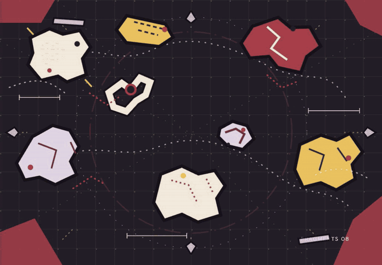

# 표지는 낯설게, 목차는 분명하게

*포트폴리오는 얼마나 친절해야 할까.*

포트폴리오를 만들면서 가장 오래 고민한 것은 색상도, 서체도 아니었다. 처음 방문한 사람이 이곳을 어떻게 경험해야 하는가에 대한 문제였다.

작업을 빠르게 확인할 수 있는 정돈된 화면은 분명 유용하다. 다만 모든 포트폴리오가 비슷한 구조를 따른다면, 정작 그 안에 담긴 사람의 취향은 어디에서 드러날까.

Readymag의 「Does a portfolio need to follow UX conventions?」를 읽으며 그 질문을 다시 꺼내 보았다.

## 01. 첫 화면에는 약간의 낯섦을 남겼다

Home의 콜라주 모션은 정보를 전달하는 데 가장 효율적인 장치가 아니다.

그럼에도 첫 화면을 움직이는 이미지와 겹쳐진 종이 조각으로 채운 것은, 프로젝트 목록에 앞서 이 페이지를 만든 사람의 감각을 보여주고 싶었기 때문이다.

기록과 이미지를 모아 두었다가 다른 맥락으로 다시 읽는 습관은 내 일상에서도 반복된다. 포트폴리오의 콜라주는 그 습관을 시각적인 언어로 옮긴 결과다.

초기에는 스크롤에 따라 모션이 진행되는 방식도 시도했다. 그러나 화면을 이해하기 위해 계속 스크롤해야 하는 경험은 생각만큼 자연스럽지 않았다. 조작에 집중하는 동안 정작 이미지의 흐름은 끊겼다.

그래서 모션의 진행을 스크롤에서 분리했다. 방문자는 움직임을 감상할 수 있고, 다시 보고 싶다면 재생 아이콘을 누르면 된다.

모든 상호작용에 사용자의 노동이 필요한 것은 아니니까.

## 02. 길을 찾는 일까지 실험으로 만들지는 않았다

첫 화면에서는 익숙한 형식을 벗어났지만, 탐색 구조는 의도적으로 단순하게 유지했다.

왼쪽 사이드바에는 Home, Projects, Blog, About, Contact를 배치했다. 어디에 무엇이 있는지 추측하게 만들고 싶지는 않았다.

Home의 마지막 화면에서도 동일한 링크를 반복하지 않았다. 이미 사이드바에 있는 길을 또 안내하는 것은 친절이라기보다 중복에 가까웠다.

프로젝트 역시 최신순으로 정렬하고, 목록에서는 설명을 짧게 줄였다. 대신 상세 페이지에서 기간, 기술, 결과물과 작업 내용을 확인할 수 있도록 했다.

**첫인상은 낯설어도, 필요한 정보까지 낯설 필요는 없다.**

이 구분은 사이트를 만드는 동안 가장 중요하게 지킨 원칙이다.

## 03. 보기 좋은 서가와 읽기 좋은 기록은 다르다

Projects와 Blog의 표현 방식도 구분했다.

프로젝트는 서로 다른 작업을 한눈에 살펴보는 서가에 가깝다. 카드의 색상과 구성을 통해 개별 작업의 성격을 드러내되, 시각적 강조는 호버하는 순간에만 나타나도록 했다.

반면 Blog는 내용을 읽으러 오는 공간이다. 글을 비교하고 선택하기 쉬운 목록과 카드 구조를 사용했다.

포트폴리오 전체가 하나의 시각적 언어를 공유하더라도 모든 페이지가 같은 방식으로 행동할 필요는 없다고 생각했다.

서가는 둘러보는 곳이고, 글은 읽는 곳이다. 각각의 목적에 맞는 사용성이 있어야 한다.

## 04. 취향에는 이유를, 정보에는 근거를

개인 사이트이기 때문에 시각적인 취향을 더 자유롭게 드러낼 수 있었다. 그렇다고 모든 디자인 선택을 취향으로 설명하고 싶지는 않았다.

콜라주 모션에는 첫인상을 남기려는 목적이 있고, 고정된 사이드바에는 탐색을 돕는 목적이 있다. 프로젝트의 짧은 소개와 상세한 본문을 분리한 것도 정보를 읽는 순서를 고려한 선택이다.

이런 선택이 언제나 정답인 것은 아니다.

누군가에게 첫 화면의 모션은 흥미로운 경험이지만, 다른 누군가에게는 목적지에 도달하기 전의 지연일 수 있다. 시각적 표현이 강할수록 로딩 속도와 가독성에도 더 주의를 기울여야 한다.

독창성을 이유로 불편함을 정당화하지는 않으려 한다.

## 05. 결국 무엇을 기억하게 할 것인가

이 사이트를 본 사람이 모든 애니메이션을 기억할 필요는 없다.

다만 작업을 살펴본 뒤, 그것을 만든 사람에게도 조금은 호기심이 생겼으면 한다.

내가 무엇을 만들었는지만큼, 무엇에 끌리고 어떤 기준으로 선택하는 사람인지 전해지기를 바랐다.

그래서 이 포트폴리오는 완전히 효율적인 이력서도, 목적 없이 돌아다니는 실험실도 아니다.

익숙한 길 위에 조금 낯선 풍경을 얹었다.

**찾아온 일은 쉽게 마치되, 예상하지 못한 장면 하나쯤은 가지고 돌아갈 수 있도록.**

## 참고

- [Readymag — Does a portfolio need to follow UX conventions?](https://blog.readymag.com/does-a-portfolio-need-to-follow-ux-conventions/)
