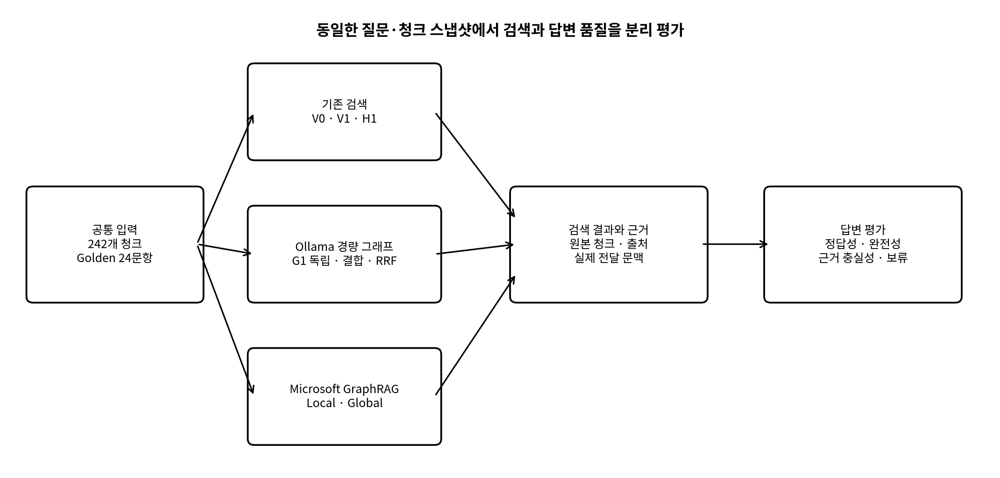
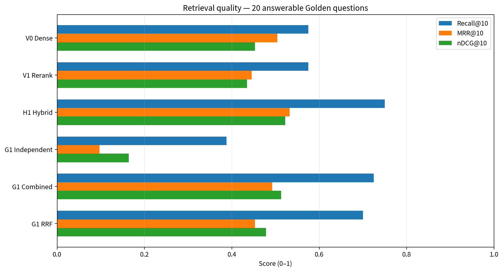
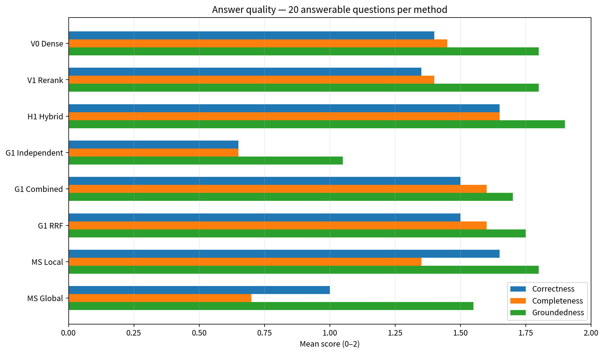
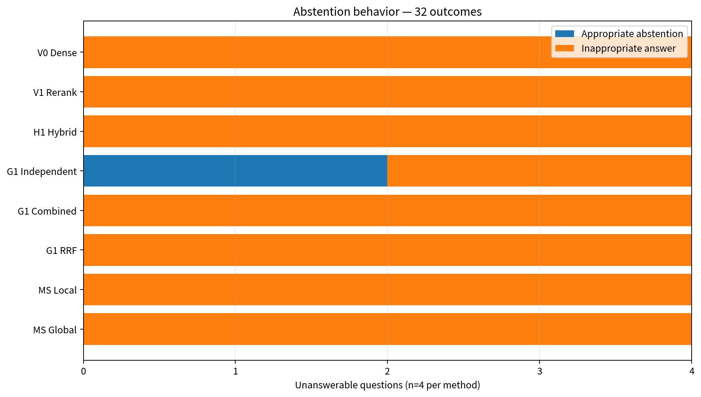
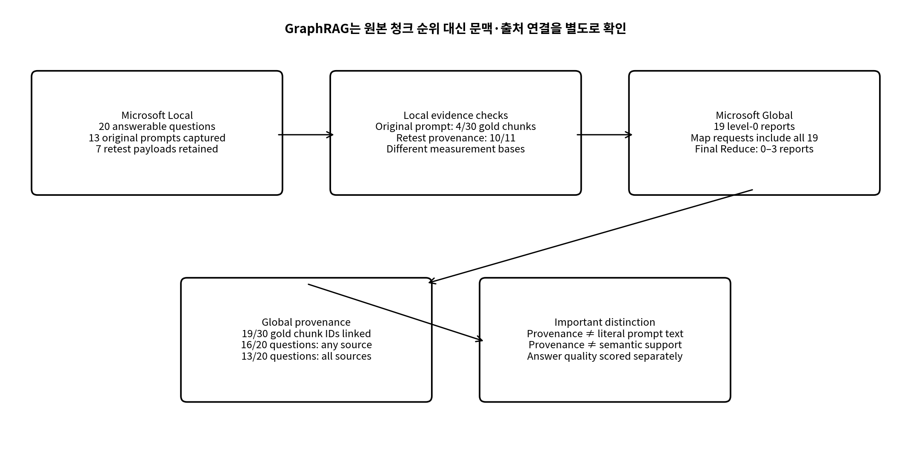
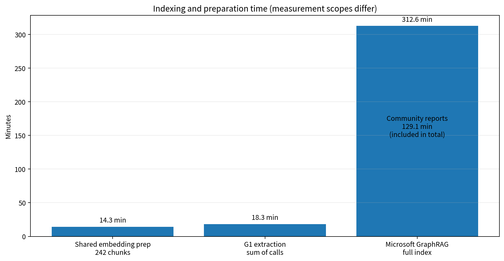

# 🔎 어떤 RAG를 실제로 선택해야 할까? — 회의록 242청크·8개 방식의 검색과 답변 품질 비교

> **한 줄 결론:** 이번 실험에서는 H1 Hybrid가 검색 지표와 답변 품질에서 가장 균형 잡힌 후보였다. 하지만 무답 질문 32건 중 적절한 보류는 2건뿐이었다. GraphRAG는 관계 탐색 가능성을 확인했지만, 기본 검색을 대체할 근거는 아직 부족하다.
>
> 실험: 2026년 11월 · AMI 회의록 4건 · 242개 청크 · Golden Set 24문항 · 8개 실험군

> **최종 판정: COMPLETE **
>
> 생성 답변에 대한 사람 검수까지 완료해 평가 결론을 확정했다. 다만 원본 trace의 기술 오류 30행은 별도 복구 자료(overlay)로 평가에 반영했으며 원본 trace 자체의 완전 복원과 과거 출력 호환성 검증은 하지 않았다.

## 목차

1. 이번에는 무엇을 증명하려 했나?
2. 242개 청크와 8개 실험군
3. 검색 성능: H1이 주요 순위 지표에서 앞섰다
4. 검색 결과가 답변 품질로 이어졌을까?
5. 무답 질문 11건을 포함하니 드러난 문제
6. Microsoft GraphRAG Local·Global은 어떻게 평가했나?
7. 색인 시간과 질의 속도까지 비교하기
8. 실험 중 복구한 오류와 남은 한계
9. 최종 선택: 지금 어떤 RAG를 사용하는 게 좋을까?

---

## 1. 이번에는 무엇을 증명하려 했나?

첫 번째 실험에서는 Dense, Reranking, Hybrid와 Ollama 기반 경량 그래프 검색을 비교했다. 하지만 그래프 검색에는 두 가지 한계가 있었다.

- 전체 2,100개 청크 중 120개만 그래프를 구축했다.
- 그래프 구축 대상과 검색 시작점에 기존 V1/H1 검색 결과가 개입했다.

이 상태로는 그래프 자체의 효과를 판단하기 어려웠다. 그래서 두 번째 실험에서는 데이터와 평가 질문을 새로 고정하고, 그래프 독립 검색과 기존 검색 결합을 분리했다. Microsoft GraphRAG도 Local과 Global을 별도 실험군으로 추가했다.

이번 실험의 질문은 하나다.

> **같은 회의록과 같은 질문을 사용했을 때, 어떤 검색 방식이 더 정확하면서도 근거에 충실한 답변을 제공할까?**

첫 번째 실험과 이번 실험은 데이터와 질문이 다르다. 따라서 **두 실험의 점수를 직접 비교하지 않았다.** 이전에 사용한 검색 알고리즘은 이번 실험의 V1 기준선으로 다시 측정했다.

## 2. 242개 청크와 8개 실험군




*그림 1. 공통 청크와 Golden 질문을 고정한 뒤 8개 실험군을 실행한다. 검색 결과, 실제 전달 문맥, 최종 답변을 별도로 기록한다.*

### 공통 입력

| 항목         | 조건                                                        |
| ---------- | --------------------------------------------------------- |
| Run ID     | `ami-golden-20261113T1102KST-approved-20261114-arm-major` |
| 원본 문서      | AMI 회의 ES2008a·b·c·d, 총 4건                                |
| 청크         | 242개                                                      |
| 청킹 결과      | 모델 처리 242/242 성공, fallback 0건                             |
| Golden Set | 24문항                                                      |
| 답변 가능      | 20문항                                                      |
| 의도된 무답     | 4문항                                                       |
| 실험군        | 8개                                                        |
| 전체 추적      | 24문항 × 8개 = 192행                                          |

Golden Set은 질문과 정답 근거를 사람이 검수하고 승인한 평가 세트다. 24문항 모두 승인 기록이 있으며, 생성 답변에 대한 사람 검수도 완료했다.

공통 청크 스냅샷 SHA256은 다음과 같다.

```text
a9b2084da489765b56d999a572be489a2c04120ce58ed28ec42b282e4644982a
```

### 비교한 8개 실험군

| 실험군                  | 검색 구조                  | 확인하려는 점                      |
| -------------------- | ---------------------- | ---------------------------- |
| **V0 Dense**         | 벡터 유사도 검색              | 의미 검색만으로 근거를 찾을 수 있는가?       |
| **V1 Reranking**     | 기존 Dense 후보 재정렬        | 현재 서비스 검색 방식을 기준선으로 삼으면 어떤가? |
| **H1 Hybrid**        | Dense + BM25 + RRF     | 의미와 키워드 검색을 결합하면 개선되는가?      |
| **G1 독립**            | 그래프만으로 검색              | 기존 검색 없이 그래프 자체가 근거를 찾는가?    |
| **G1 기존 결합**         | 그래프 점수와 기존 검색 점수 결합    | 그래프가 기존 검색을 보완하는가?           |
| **G1 RRF**           | 그래프와 기존 검색의 순위 결합      | 순위 기반 결합이 더 나은가?             |
| **Microsoft Local**  | 엔티티·관계·원문 문맥 통합        | 개체 관계를 따라 질문에 답하는가?          |
| **Microsoft Global** | 커뮤니티 보고서 기반 Map-Reduce | 여러 회의의 공통 주제를 종합하는가?         |

V1은 현재 서비스의 `PGVectorSearch`가 사용하는 Dense Top-10 후보와 `_rank_score` 재정렬을 재현한 기준선이다.

G1은 242개 청크 전체를 그래프 입력으로 사용했다. 독립 검색은 V0/V1/H1 결과를 시작점으로 사용하지 않는다.

## 3. 검색 성능: H1이 주요 순위 지표에서 앞섰다

검색 평가는 답변 가능한 Golden 질문 20개를 대상으로 한다. 자료에 정답 근거가 없는 4개 질문은 검색 지표의 분모에서 제외했다.

- **Hit@k:** 상위 k개 안에 정답 근거가 하나 이상 포함된 질문의 비율
- **Recall@k:** 정답 근거 청크 전체 중 상위 k개가 회수한 비율
- **MRR@10:** 첫 정답 근거가 얼마나 앞쪽에 등장하는지 나타내는 지표
- **nDCG@10:** 여러 정답 근거의 순위와 상대적 위치를 함께 반영하는 지표




*그림 2. 답변 가능한 20문항 기준. Microsoft Local·Global은 원본 청크 순위 목록을 반환하지 않아 순위 지표에서 제외했다.*

| 실험군              |    Hit@3 |    Hit@5 |   Hit@10 | Recall@10 |   MRR@10 |  nDCG@10 |
| ---------------- | --------: | --------: | --------: | ---------: | --------: | --------: |
| V0 Dense         |     0.550 |     0.700 |     0.700 |      0.575 |     0.504 |     0.453 |
| V1 Reranking     |     0.550 |     0.650 |     0.700 |      0.575 |     0.445 |     0.435 |
| **H1 Hybrid**    | **0.650** |     0.650 | **0.850** |  **0.750** | **0.532** | **0.522** |
| G1 독립            |     0.200 |     0.200 |     0.400 |      0.388 |     0.097 |     0.164 |
| G1 기존 결합         |     0.600 | **0.800** | **0.850** |      0.725 |     0.492 |     0.513 |
| G1 RRF           | **0.700** |     0.700 |     0.800 |      0.700 |     0.453 |     0.478 |
| Microsoft Local  |       N/A |       N/A |       N/A |        N/A |       N/A |       N/A |
| Microsoft Global |       N/A |       N/A |       N/A |        N/A |       N/A |       N/A |

H1은 **Recall@10, MRR@10, nDCG@10에서 가장 높았다.** Hit@10은 G1 기존 결합과 공동 최고였다. G1 RRF는 Hit@3, G1 기존 결합은 Hit@5에서 가장 높은 값을 기록했다.

반면 G1 독립 검색은 Hit@10 0.400, MRR@10 0.097에 그쳤다. 그래프만으로 검색하는 경로는 이번 데이터에서 약세를 보였다. 그래프와 기존 검색을 결합하면 결과가 좋아졌지만, H1의 주요 순위 지표를 넘지는 못했다.

검색 평균 시간도 차이가 있었다.

| 실험군          |   검색 평균 |
| ------------ | ------: |
| V0 Dense     | 376.8ms |
| V1 Reranking | 155.9ms |
| H1 Hybrid    | 129.1ms |
| G1 독립        |   4.6ms |
| G1 기존 결합     |   8.1ms |
| G1 RRF       |   3.6ms |

G1의 검색 시간은 그래프가 이미 구축된 뒤의 검색 단계만 측정했다. 그래프 추출·색인 시간은 포함하지 않았기 때문에 이 숫자만으로 G1이 전체 시스템에서 가장 빠르다고 결론을 내릴 순 없다.

## 4. 검색 결과가 답변 품질로 이어졌을까?

검색 성능이 높아도 답변이 정확하다는 보장은 없다. 이번에는 답변 가능한 질문 20개에 대해 각 실험군의 답변을 평가했다.

평가 항목은 세 가지이며 각각 0\~2점이다.

1. **정답성:** Golden 정답과 비교해 답이 맞는가?
2. **완전성:** 질문에서 요구한 필수 내용을 빠뜨리지 않았는가?
3. **근거 충실성:** 답변의 주요 주장이 모델에 실제 전달된 문맥으로 뒷받침되는가?

세 점수는 합산하지 않았다. 각 항목은 서로 다른 품질을 측정하기 때문이다.




*그림 3. 답변 가능한 질문 20개씩, 총 160개 답변의 평균 점수. GPT-6 직접 평가와 생성 답변에 대한 사람 검수를 완료했다.*

| 실험군              |  평가 수 |      정답성 |      완전성 |   근거 충실성 |
| ---------------- | ----: | -------: | -------: | -------: |
| V0 Dense         | 20/20 |     1.40 |     1.45 |     1.80 |
| V1 Reranking     | 20/20 |     1.35 |     1.40 |     1.80 |
| **H1 Hybrid**    | 20/20 | **1.65** | **1.65** | **1.90** |
| G1 독립            | 20/20 |     0.65 |     0.65 |     1.05 |
| G1 기존 결합         | 20/20 |     1.50 |     1.60 |     1.70 |
| G1 RRF           | 20/20 |     1.50 |     1.60 |     1.75 |
| Microsoft Local  | 20/20 | **1.65** |     1.35 |     1.80 |
| Microsoft Global | 20/20 |     1.00 |     0.70 |     1.55 |

H1은 완전성과 근거 충실성에서 가장 높은 평균을 기록했다. 정답성은 Microsoft Local과 1.65점으로 공동 최고였다.

Microsoft Local은 정답성 평균이 H1과 같았지만 완전성은 1.35점이었다. 답변이 문맥을 벗어나지 않더라도 질문에서 요구한 핵심 요소를 빠뜨릴 수 있다는 뜻이다.

G1 기존 결합과 G1 RRF는 독립 검색보다 높은 답변 점수를 기록했다. 그래프 자체의 독립 검색보다 기존 검색 결과를 함께 활용했을 때 답변 품질이 개선되는 경향을 확인했다. 다만 이번 표본만으로 일반적인 우위를 주장할 수는 없다.

### Local의 20개 답변은 하나의 평가군으로 통합했다

Microsoft Local은 답변 가능한 질문 20개 전체를 하나의 평가군으로 채점했다. 원래 실행에서 실제 prompt가 보존된 13건과 별도 재평가에서 답변·전달 문맥을 보존한 7건을 분리된 성능군으로 취급하지 않았다.

7건의 재평가 자료는 기존 답변 해시와 새로 보존한 답변·문맥을 대조했다. 기존 Qwen 점수는 재사용하지 않았고, Local 20건은 동일한 GPT-6 평가 기준으로 비교했다.

단, Local의 원래 prompt 13건과 별도 재평가 7건은 문맥 출처를 확인한 방식이 다르다. 따라서 두 집단의 provenance 수치를 하나의 검색 Recall처럼 합치지 않았다.

## 5. 무답 질문 11건을 포함하니 드러난 문제

이번 Golden Set에는 자료만으로 답할 수 없는 질문이 4개 있다. RAG는 답할 수 있는 질문에 잘 답하는 것뿐 아니라, 근거가 없을 때 답변을 보류해야 한다.

이전 평가에서는 무답 질문 중 11건이 기술 오류로 남아 있었다. 이번에는 해당 11건을 다시 실행했다.

> **중요 결과**
>
> 11건 모두 실행은 완료됐지만, 답변을 보류해야 하는 질문에 실제 답변을 생성했다. 적절한 보류는 0/11건이었다.

전체 8개 실험군의 무답 질문은 4개씩, 총 32건이다.




*그림 4. 32개 무답 응답 중 적절한 보류와 부적절한 답변. 기술 오류로 제외한 건은 없다.*

| 실험군              |   적절한 보류 |   부적절한 답변 |
| ---------------- | -------: | --------: |
| V0 Dense         |      0/4 |       4/4 |
| V1 Reranking     |      0/4 |       4/4 |
| H1 Hybrid        |      0/4 |       4/4 |
| G1 독립            |  **2/4** |       2/4 |
| G1 기존 결합         |      0/4 |       4/4 |
| G1 RRF           |      0/4 |       4/4 |
| Microsoft Local  |      0/4 |       4/4 |
| Microsoft Global |      0/4 |       4/4 |
| **전체**           | **2/32** | **30/32** |

이전 기술 오류 11건은 이번 평가에서 제외하지 않았다. 모두 재실행 결과가 남았고, 11건 모두 부적절한 답변으로 집계했다. 전체 무답 평가에서 기술 오류로 제외된 건은 0건이다.

이 결과는 중요한 약점을 보여준다. H1은 검색과 답변 품질에서 가장 좋은 균형을 보였지만, 무답 질문에서는 4건 모두 답변을 생성했다. **검색 성능과 답변 안전성은 별도의 문제다.**

G1 독립은 4건 중 2건을 적절히 보류했지만, 답변 가능한 질문의 정답성·완전성 평균이 각각 0.65점이었다. 보류 능력 하나만으로 서비스에 적합하다고 볼 수 없다.

## 6. Microsoft GraphRAG Local·Global은 어떻게 평가했나?

Microsoft GraphRAG는 일반 RAG처럼 정렬된 원본 청크 목록을 직접 반환하지 않는다. 따라서 일반 검색에서 사용하는 Hit@k, Recall@k, MRR, nDCG를 그대로 계산할 수 없다.

이것은 검색 품질을 평가할 수 없다는 뜻이 아니다. 평가 단위를 바꿔야 한다.

```text
일반 RAG
질문 → 원본 청크 순위 → 모델에 전달된 청크 → 답변

Microsoft Local
질문 → 엔티티·관계·텍스트 유닛 → 통합 문맥 → 답변

Microsoft Global
질문 → 커뮤니티 보고서 → Map → Reduce → 답변
```

### 색인 결과

| 항목           |  결과 |
| ------------ | --: |
| 입력 text unit | 242 |
| 엔티티          | 499 |
| 관계           | 527 |
| 커뮤니티         |  85 |
| 커뮤니티 보고서     |  85 |
| Level 0 보고서  |  19 |

`community_level=0`은 색인 결과가 0개라는 뜻이 아니라 질의 설정에서 사용하는 계층 수준이다. 실제로는 Level 0 보고서 19개가 생성됐다.

### Local: 실제 전달 문맥과 그래프 출처를 구분한다

Local은 엔티티·관계·원문 text unit 등을 결합해 답변 문맥을 만든다.

- 원래 실행에서 답변 가능한 질문 20건 중 13건의 최종 prompt를 직접 확인했다.
- 이 13건의 prompt에서는 Golden 정답 청크 30개 중 4개가 원문 text로 확인됐다.
- 나머지 7건은 별도 재평가에서 답변과 실제 전달 문맥을 보존했다.
- 별도 재평가 7건에서는 Golden 근거 11개 중 10개가 GraphRAG의 mapped-context provenance에 연결됐다.
- 이 10/11은 원문 청크 텍스트가 prompt에 그대로 들어갔다는 뜻이 아니다. 그래프 provenance 연결을 기준으로 한 값이다.

따라서 `4/30`과 `10/11`을 더해 Local Recall로 만들지 않았다.

### Global: 보고서의 출처와 답변 문맥은 다르다

Global은 커뮤니티 보고서를 사용해 질문에 대한 답을 단계적으로 만든다.

- 답변 가능한 질문의 Map 요청에서 Level 0 보고서 19개가 모두 확인됐다.
- 최종 Reduce 요청에 직접 포함된 보고서 원문은 질문별 0\~3개였다.
- Level 0 보고서의 provenance에는 Golden 근거 청크 30개 중 19개가 연결됐다.
- 20개 답변 가능 질문 중 16개는 하나 이상의 Golden 근거 출처가 연결됐고, 13개는 모든 Golden 근거 출처가 연결됐다.

하지만 provenance에 원본 청크가 연결됐다고 보고서 내용이 정답을 의미적으로 뒷받침한다는 뜻은 아니다. 따라서 답변 근거 충실도는 provenance 목록을 임의로 합치지 않고 **실제 최종 Reduce 문맥**을 기준으로 평가했다.




*그림 5. Local의 원문 prompt 확인과 재평가 provenance, Global의 보고서 provenance는 측정 기준이 다르므로 하나의 Recall로 합치지 않았다.*

## 7. 색인 시간과 질의 속도까지 비교하기

검색 정확도만으로 실제 서비스에 적용할 방식을 정할 수는 없다. 색인 시간, 질문 처리 시간, 메모리 사용량도 고려해야 한다.




*그림 5. 공통 임베딩과 G1은 준비·호출 시간 합계, Microsoft는 전체 색인 wall time이다. 처리 범위가 다르므로 절대적인 속도 경쟁으로 해석하지 않는다.*

### 색인·준비 시간

| 단계                       |           소요 시간 | 범위                             |
| ------------------------ | --------------: | ------------------------------ |
| 공통 EmbeddingGemma 2 임베딩  |         14분 21초 | 242개 청크                        |
| G1 그래프 추출                |         18분 20초 | 청크별 순차 호출 시간 합계, wall time 미기록 |
| Microsoft GraphRAG 전체 색인 | **5시간 12분 33초** | 242개 text unit 전체              |
| └ Graph 추출               |     1시간 38분 42초 | 전체 색인 내부 단계                    |
| └ Community Report 생성    |   **2시간 9분 5초** | 전체 색인 내부 단계                    |
| └ Embedding 생성           |     1시간 24분 44초 | 전체 색인 내부 단계                    |

Microsoft GraphRAG의 Python peak RSS는 약 **2.69 GiB**였다.

G1은 242개 청크 전체를 처리해 개체 언급 954건과 개체 간 관계 언급 526건을 추출했다.

### 질문 처리 시간

| 실험군              |   검색 평균 | 답변 생성 또는 질의 전체 평균 |
| ---------------- | ------: | ----------------: |
| V0 Dense         | 376.8ms |            20.17초 |
| V1 Reranking     | 155.9ms |            21.08초 |
| H1 Hybrid        | 129.1ms |            20.77초 |
| G1 독립            |   4.6ms |            11.01초 |
| G1 기존 결합         |   8.1ms |            21.19초 |
| G1 RRF           |   3.6ms |            18.71초 |
| Microsoft Local  |     N/A |        **41.81초** |
| Microsoft Global |     N/A |       **145.36초** |

일반 RAG는 검색과 답변 생성 시간을 나눠 기록했다. Microsoft GraphRAG는 검색과 답변 생성 시간을 분리해 측정하지 않아 **질문 입력부터 최종 답변 생성까지 걸린 전체 시간**을 사용했다. 따라서 표의 두 열을 단순히 같은 측정 구간으로 비교해서는 안 된다.

## 8. 실험 중 복구한 오류와 남은 한계

### 8-1. 청킹 응답을 JSON Schema로 고정했다

처음에는 Ollama에 JSON만 반환하라고 프롬프트로 요청했다. C, D 회의에서 유효하지 않은 JSON이 발생했고, 긴 재시도 안내가 입력 예산을 넘으면서 fallback이 발생했다.

요청 자체에 JSON Schema를 전달하고, 응답 예산을 1,024토큰으로 제한했다. 재시도 안내도 짧게 고정했다.

최종 결과는 다음과 같다.

```text
전체 청크:       242
모델 처리 성공:  242
Fallback:        0
중복 ID:         0
빈 본문:         0
위치 누락:       0
```

### 8-2. 답변 생성 오류와 평가 누락을 분리했다

답변 가능한 질문에서 처음 발생한 기술 오류 30건은 재시도 결과를 확보했다. 이 중 23건은 답변 본문이 별도 복구 overlay에 보존됐고, Microsoft Local 7건은 별도 재평가에서 답변과 실제 전달 문맥을 보존했다.

23건의 답변 본문은 로컬 `qwen3:4b-instruct`로 재생성했다. 총 741.8초가 걸렸다. 이는 원래 생성 답변을 그대로 복원한 것이 아니라 평가를 위해 재생성한 대체 본문이다.

또한 이전에 기술 오류로 남아 있던 의도된 무답 질문 11건을 다시 실행했다. 이 11건은 모두 완료됐지만, 모두 답변을 생성했다.

### 8-3. 결과를 해석할 때 남는 제한

- **표본:** 회의록 4건과 Golden 질문 24개다. 다른 문서 종류와 서비스 전체 질문으로 일반화할 수 없다.
- **답변 평가:** 답변 가능한 160건을 GPT-6가 평가했고, 생성 답변에 대한 사람 검수도 완료했다. Golden 질문과 정답 근거의 승인 절차와 생성 답변 검수는 구분해 기록했다.
- **무답 처리:** 전체 무답 평가 32건 중 적절한 보류는 2건뿐이다. 나머지 30건은 부적절한 답변이었다.
- **추적 보존:** 원본 trace 192행 중 지정된 11행만 갱신했고 나머지 181행은 바이트 그대로 보존했다. 답변 본문 복구 자료는 별도 overlay로 유지했다.
- **인용 검사:** 인용 ID 검사는 구조적 유효성만 확인한다. 빈 인용 목록이나 유효한 ID가 답변 주장의 의미상 근거 충실성을 보장하지 않는다.
- **통계적 한계:** 24문항 결과만으로 통계적 유의성이나 일반적 우위를 주장할 순 없다.

최종 평가 판정은 **COMPLETE**다. 답변 가능한 질문 160건의 GPT-6 평가와 생성 답변에 대한 사람 검수를 모두 마쳤기 때문이다.

## 9. 최종 선택: 지금 어떤 RAG를 사용하는 게 좋을까?

이번 실험은 특정 기술의 우수성을 보여주는 것이 아니라 실제 서비스에서 선택할 수 있는 방식을 찾는 것이 목적이었다.

| 사용 상황            | 이번 실험의 판단     | 근거                                           |
| ---------------- | ------------- | -------------------------------------------- |
| 현재 서비스 기본값       | **V1 유지**     | 무답 질문에서 부적절한 답변이 발생해, 안전한 보류 기능을 보완하기 전까지 유지 |
| 다음 교체 후보         | **H1 우선 파일럿** | 주요 검색 지표와 답변 품질에서 가장 균형이 좋음                  |
| 그래프 독립 검색        | 기본 도입 보류      | 검색·답변 품질이 낮음                                 |
| G1 그래프 결합        | 추가 실험 후보      | 독립 검색보다 나았지만 H1을 넘는 근거는 부족                   |
| Microsoft Local  | 특화 후속 후보      | 정답성은 H1과 같지만 완전성은 낮고 질의 시간이 김                |
| Microsoft Global | 기본 도입 보류      | 답변 완전성이 낮고 색인·질의 비용이 큼                       |

### 최종 판단

**🥳H1🥳**

H1은 이번 20개 답변 가능 질문에서 검색 Recall@10, MRR@10, nDCG@10가 가장 높았다. 답변 정답성은 Microsoft Local과 공동 최고였고, 완전성과 근거 충실성은 가장 높았다.

하지만 H1은 무답 질문 4건 모두에서 답변을 생성했다. 이 문제를 해결하지 않으면 검색 지표가 높아도 서비스에 바로 적용하기 어렵다.

Microsoft Local은 관계형 문맥을 활용할 수 있는 후속 후보지만, 답변 완전성과 실행 비용을 함께 고려해야 한다. Global은 여러 문서를 종합하는 구조를 확인했지만 이번 표본에서 기본 검색 경로로 선택할 근거가 부족했다.

> **좋은 RAG는 검색 점수가 높은 RAG가 아니라, 필요한 근거를 찾고, 빠짐없이 답하고, 근거가 없을 때는 멈출 수 있는 RAG다.**

---

## 실험 산출물과 재현 기록

- `EXPERIMENT_REPORT_2.md`
- `question_level_comparison.csv`
- `answer_quality_metrics.json`
- `context_coverage_metrics.json`
- `efficiency_metrics.json`
