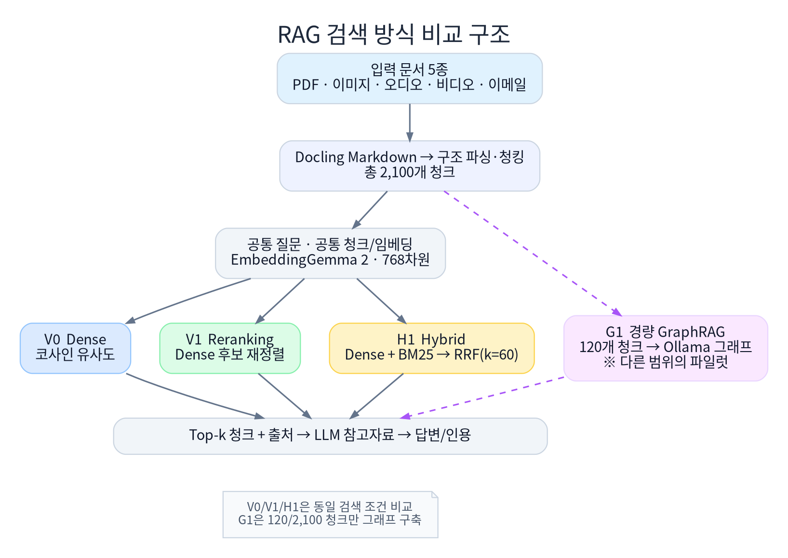
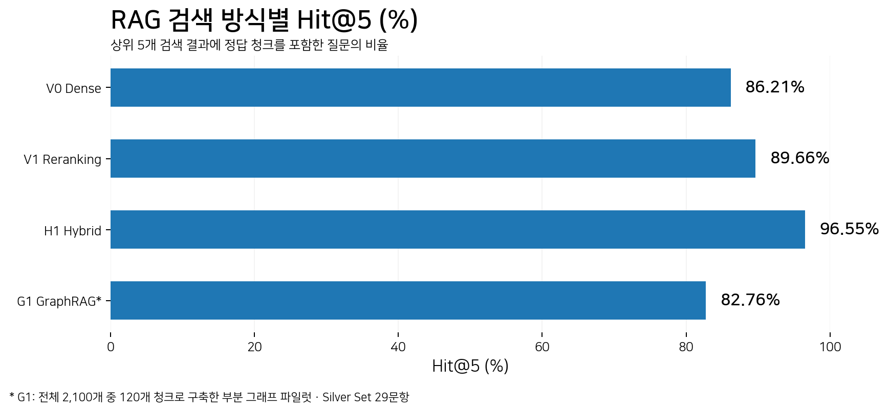
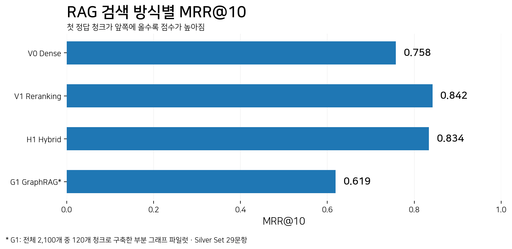
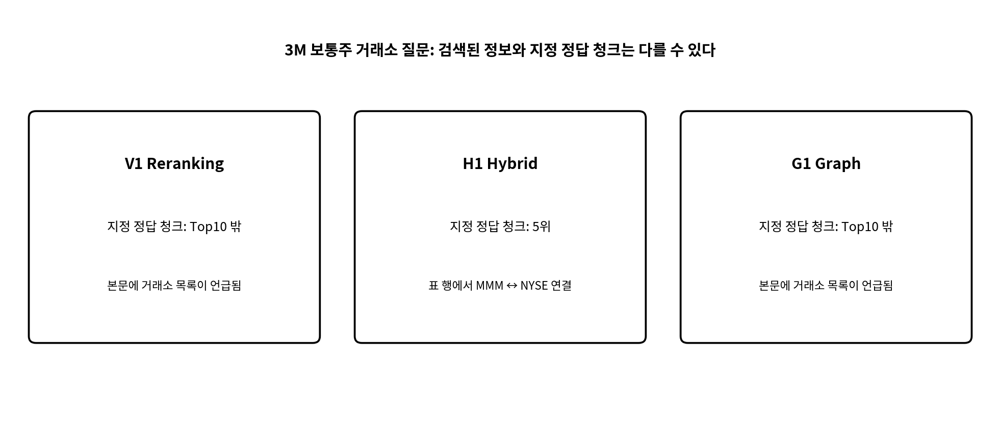

# 🔎 RAG 검색은 Dense만으로 충분할까? — BM25·RRF·GraphRAG 직접 비교

> **한 줄 결론:** 이 실험에서는 Hybrid가 정답 근거를 더 자주 찾았고, 기존 재정렬은 정답을 더 앞쪽에 배치했다. GraphRAG는 더 복잡했지만 추가 근거 회수 이점을 확인하지 못했다.
>
> 실험: 2026년 11월 · Python · Docling · EmbeddingGemma · BM25 · Ollama

## 목차

1. 무엇을 검증하려 했나?
2. 실험 아키텍처와 데이터
3. 검색 방식별 핵심 구현
4. 29문항의 정량 결과
5. 실제 질문을 끝까지 추적해 보기
6. GraphRAG에서 발생한 오류와 개선
7. 실험의 한계와 최종 선택

---

## 1. 무엇을 검증하려 했나?

RAG(Retrieval-Augmented Generation)는 질문을 받으면 관련 문서를 검색한 뒤, 검색한 내용을 LLM의 참고자료로 전달해 답변을 생성한다.

여기서 가장 먼저 확인할 것은 **LLM이 답변을 잘 쓰는가**가 아니라 **답의 근거를 제대로 찾았는가**이다. 근거가 빠져 있으면 좋은 생성 모델을 써도 그 정보에 근거한 답변을 만들기 어렵다.

처음 사용하던 방식은 Dense 검색 결과를 재정렬하는 V1이었다. 이번에는 다음 두 가지가 궁금했다.

- 단어 일치에 강한 BM25를 결합하면, 숫자나 고유명사가 포함된 근거를 더 잘 찾을까?
- 엔티티와 관계를 연결하는 GraphRAG를 추가하면 기존 검색으로 놓친 근거를 발견할까?

**먼저 결론을 말하면, H1(BM25+RRF)은 Hit@5가 가장 높았다. 그러나 정답의 첫 등장 순위를 측정한 MRR@10은 V1이 더 높았다.** 따라서 단일 지표만 보고 검색 방식을 바꿀 수는 없었다.

## 2. 실험 아키텍처와 데이터



*그림 1. 동일한 청크·임베딩을 사용한 V0/V1/H1 비교와, 일부 청크만 그래프화한 G1 파일럿.*

이번 실험은 PDF, 이미지, 오디오, 비디오, 이메일 문서군에서 만들어진 **Docling Markdown 5종**을 입력으로 사용했다. 원본 미디어를 새로 파싱한 실험은 아니다.

- **전체 청크:** 2,100개. 그중 PDF 관련 청크가 2,043개였다.
- **임베딩:** EmbeddingGemma 2, 768차원.
- **평가 질문:** 29개 Silver Set. 사람의 최종 검수를 마친 Golden Set이 아니다.
- **공정 비교 구간:** V0/V1/H1은 같은 청크와 임베딩을 사용했다.
- **G1 범위:** 비용과 실행 시간의 제약으로 120개 청크만 그래프로 추출했다. 기존 V1/H1 기록을 재사용한 부분 실험이다.

즉 **V0/V1/H1의 성능 비교**와 **G1의 가능성 검토**는 구분해야 한다. 아래 표와 그래프에 G1을 함께 표시해도, 동일 범위의 완전한 대조 실험이라는 뜻은 아니다.

### 네 가지 검색 방식

**V0 — Dense 검색**

질문과 청크를 임베딩 벡터로 변환하고 코사인 유사도가 높은 순서로 검색한다. 문장 표현이 달라도 의미가 비슷하면 찾을 수 있지만, 정확한 숫자·종목코드·표의 특정 행을 놓칠 수 있다.

**V1 — Dense 검색 + 기존 재정렬**

Dense가 찾은 후보를 다시 정렬한다. 기존 구현은 코사인 점수를 바탕으로 질문 토큰의 일치도와 문자 단위 겹침을 반영하고, 정보량이 적은 짧은 청크에는 감점을 적용한다. 따라서 **후보 검색 범위가 그대로라면 새 청크를 발견하는 방식이 아니라 순서를 바꾸는 방식**이다.

**H1 — Dense + BM25 + RRF**

Dense 검색과 단어 기반 BM25 검색을 각각 수행한 다음, **RRF(Reciprocal Rank Fusion)**로 두 결과의 순위를 결합한다. 서로 다른 검색 방식이 찾은 청크를 하나의 목록으로 합칠 수 있다.

**G1 — Ollama 기반 경량 그래프 검색**

Ollama(`qwen3:4b-instruct`)로 청크에서 개체와 관계를 추출한 뒤, 질문과 연결되는 관계 정보를 검색에 활용했다. 이는 직접 만든 경량 파일럿이며 **Microsoft GraphRAG의 Local/Global Search 성능을 평가한 것이 아니다.**

## 3. 검색 방식별 핵심 구현

### 3-1. V1: 검색된 후보를 다시 정렬한다

핵심은 **코사인 유사도만으로 순위를 결정하지 않는 것**이다. 기존 구현의 점수 계산 중 중요한 부분만 옮기면 다음과 같은 형태다.

```python
# V1 점수 계산 원리를 보여주는 축약 함수
# query_tokens/body_tokens, query_grams/body_grams는 각 텍스트에서 추출한 집합

def rerank_score(cosine_score, query_tokens, body_tokens,
                 query_grams, body_grams):
    exact = (len(query_tokens & body_tokens) / len(query_tokens)
             if query_tokens else 0.0)
    char_overlap = (len(query_grams & body_grams) / len(query_grams)
                    if query_grams else 0.0)
    score = cosine_score + 0.20 * max(exact, char_overlap)
    return max(0.0, min(1.0, score))

# 실제 구현에는 짧은 청크 감점도 포함된다.
```

Dense가 발견한 후보 중 질문 단어와 더 밀접한 청크를 위로 올리는 방식이다. 다만 처음 후보 10개에 정답 청크가 없으면 재정렬만으로는 그 청크를 새로 찾을 수 없다.

### 3-2. H1: 점수가 아니라 순위를 합친다

BM25 점수와 코사인 유사도는 계산 기준이 다르다. 두 점수를 그대로 더하는 대신, 이번 실험에서는 **RRF**를 사용했다.

```text
RRF(청크) = Σ [ 1 / (60 + 검색 방식별 순위) ]
```

예를 들어 어떤 청크가 Dense 2위, BM25 4위라면 다음과 같이 더한다.

```text
1 / (60 + 2) + 1 / (60 + 4)
= 1/62 + 1/64
≈ 0.03175
```

`k=60`은 상위 순위 하나의 영향이 지나치게 커지는 것을 완화하는 순위 보정값이다. 확률로 정규화하는 값은 아니다.

**실험 실행 코드의 `rrf_merge()` 핵심 구현:**

```python
def rrf_merge(dense, sparse, k=60):
    scores = {}
    for ranked in (dense, sparse):
        for i, (chunk_id, _) in enumerate(ranked, 1):
            scores[chunk_id] = scores.get(chunk_id, 0.0) + 1.0 / (k + i)
    return sorted(scores.items(), key=lambda x: (-x[1], x[0]))
```

실험에서는 Dense Top10과 BM25 Top10을 결합했다. 따라서 H1은 V1과 달리 **Dense 후보에 없던 청크를 BM25에서 가져올 수 있다.**

### 3-3. G1: JSON Schema로 그래프 추출 형식을 고정한다

G1은 청크에서 `entities`와 `relations`를 뽑아야 한다. 처음에는 단순 JSON 출력만 요청했는데, 모델이 기대한 객체 대신 다른 형태를 반환해 검증 실패가 발생했다.

이후 Ollama의 `/api/chat` 요청에서 `format`에 JSON Schema 객체를 전달하는 방식으로 변경했다.

```python
# G1 JSON Schema 출력 요청의 핵심 형태 (설명용 축약 코드)
payload = {
    "model": "qwen3:4b-instruct",
    "stream": False,
    "format": extraction_schema,  # JSON Schema 객체
    "messages": [
        {"role": "system", "content": extraction_instruction},
        {"role": "user", "content": chunk_text},
    ],
}
```

여기서 중요한 것은 **JSON으로 파싱된다고 해서 올바른 그래프 데이터인 것은 아니라는 점**이다. 반환값의 타입과 필수 필드를 검증하고, 실패한 청크만 재시도해야 한다.

## 4. 29문항에서 실제로 얼마나 달랐을까?

### Hit@5: 상위 5개 안에 정답 근거가 있는가?



*그림 2. 29문항 Silver Set 기준 Hit@5. G1은 부분 그래프 파일럿이다.*

- V0 Dense: **86.21%** (25/29)
- V1 Reranking: **89.66%** (26/29)
- **H1 Hybrid: 96.55% (28/29)**
- G1 GraphRAG: **82.76%** (24/29)

H1은 V1보다 **2문항을 더 성공**했다. 백분율로는 6.90%p 차이지만, 절대적인 표본 수로 보면 두 질문의 차이다.

### MRR@10: 정답 근거를 얼마나 앞쪽에 놓았는가?



*그림 3. 첫 정답 근거 순위의 역수를 질문별로 평균한 MRR@10.*

- V0 Dense: **0.758**
- **V1 Reranking: 0.842**
- H1 Hybrid: **0.834**
- G1 GraphRAG: **0.619**

H1은 근거 회수 측면에서 유리했지만, 첫 정답의 순위는 V1이 약간 더 좋았다. **Hit@5와 MRR@10은 같은 질문에 답하는 지표가 아니다.**

또한 G1은 전체 그래프를 구축하지 않았으므로 이 수치만으로 GraphRAG 일반의 우열을 판단해서는 안 된다.

## 5. 실제 질문을 끝까지 추적해 보기

점수만 보면 H1이 좋아 보인다. 하지만 질문부터 최종 답변까지 따라가 보니 평가에서 놓치기 쉬운 문제가 드러났다.



*그림 4. 지정한 정답 청크의 검색 순위와, 검색된 본문 자체에 들어 있던 정보는 구분해서 읽어야 한다.*

### 질문 — 3M의 보통주는 어느 거래소에 상장되어 있나?

**원래 평가 질문:** `Which exchange is listed for 3M common stock?`

**① 검색된 청크**

- **V1:** 지정된 정답 청크는 Top10 밖. 다만 1위 본문 청크에는 거래소 목록이 등장했다.
- **H1:** 보통주, 종목코드 `MMM`, 등록 거래소를 연결하는 **표 행 청크를 5위**에 배치했다.
- **G1:** 지정된 정답 청크는 Top10 밖. V1과 마찬가지로 거래소 목록을 포함한 본문 청크는 검색됐다.

**② 청크 출처**

세 방식 모두 `3M_2022_10K.md`(3M 2022 Form 10-K)를 검색했다. H1이 정답으로 매핑한 청크는 **증권 등록 표의 보통주 행**이고, V1/G1의 최상위 청크는 **여러 거래소를 설명하는 본문**이었다. 원본 추적에는 페이지 번호나 검증된 URL이 없어 이를 새로 만들지 않았다.

**③ 모델에 전달한 참고자료**

- **V1/G1:** 본문에 NYSE·Chicago Stock Exchange·SIX Swiss Exchange가 언급된 자료를 전달했다.
- **H1:** `Common Stock` / `MMM` / `New York Stock Exchange`의 대응이 명확한 표 행 자료를 전달했다.

위 문장은 실제 전달 payload의 **내용을 요약한 것**이며, 프롬프트 전문을 복제한 것은 아니다.

**④ 최종 답변**

- **V1:** New York Stock Exchange, Chicago Stock Exchange, SIX Swiss Exchange
- **H1:** New York Stock Exchange
- **G1:** New York Stock Exchange, Chicago Stock Exchange, SIX Swiss Exchange

**⑤ 무엇을 확인했나?**

H1은 지정 정답 청크를 찾았고 V1/G1은 찾지 못했다. 하지만 V1/G1도 거래소 관련 정보를 전혀 검색하지 못한 것은 아니다. 자동 평가의 정답 청크는 특정 **표 행 한 개**로 매핑돼 있었기 때문이다.

따라서 **지정 정답 청크를 찾았는가(Hit@k)**와 **최종 답변이 실제로 정확한가**는 따로 확인해야 한다. 이번 기록에서 인용 ID가 검색 목록에 있는지는 검사했지만, 답변 주장과 근거의 의미적 일치까지 사람의 검수로 확정한 것은 아니다.

### 답변이 맞아 보여도 인용은 틀릴 수 있다

또 다른 질문(P03)은 3M이 어느 주에 설립됐는지 묻는다. V1/H1/G1 모두 `Delaware`라고 답했다. 그런데 G1의 인용 ID 한 개는 해당 방식의 검색 결과 목록에 없었다.

이 사례에서 알 수 있는 점은 **검색 품질, 답변 내용, 인용 무결성은 서로 다른 검증 대상**이라는 사실이다.

## 6. GraphRAG에서 발생한 오류와 개선

처음 G1은 선택한 120개 청크 중 **57개만 그래프 추출에 성공하고 63개는 실패**했다. 단순 JSON 형식 요청으로는 `entities`가 원하는 객체 구조로 일관되게 나오지 않았다.

JSON Schema를 적용하고 실패한 63개만 재시도했다.

```text
최초:      120개 대상 → 57개 성공 / 63개 실패
Schema 적용: 실패 63개 → 61개 복구 / 2개 실패
최종:      120개 대상 → 118개 성공 / 2개 실패
```

구조화 출력이 안정되면서 G1 검색 지표도 바뀌었다.

- **기존 JSON 출력:** Hit@5 **51.72%**, MRR@10 **0.300**
- **JSON Schema 최종:** Hit@5 **82.76%**, MRR@10 **0.619**
- 반면 Hit@10은 **96.55% → 89.66%**로 낮아졌다. 모든 지표가 동시에 개선된 것은 아니다.

더 중요한 결과는 최종 G1이 **V1/H1의 Top10 합집합 바깥에서 새로운 정답 청크를 0건 발견**했다는 점이다. 구축 범위가 제한된 파일럿에서는 그래프를 추가한 비용에 비해 새로운 근거를 얻었다고 보기 어려웠다.

다만 이 결과는 **Ollama 기반 경량 G1 파일럿**에만 해당한다. Microsoft GraphRAG Local/Global의 성능을 측정한 결과는 아니다.

## 7. 실험의 한계와 최종 선택

이번 수치를 서비스 전체 성능으로 일반화할 수 없는 이유도 분명하다.

- **Silver Set 29문항:** 사람이 확정한 Golden Set이 아니다. 29문항의 정답이 **10개 고유 청크에 중복 매핑**돼 있어 표본 다양성이 낮다.
- **문서 변환 한계:** Markdown에서 차트 수치와 영상의 시각적 동작 등 일부 정보가 빠졌다. 검색 이전 단계에서 사라진 정보는 검색 방식을 바꿔도 회수할 수 없다.
- **오프라인 검색 실험:** 실제 운영 DB의 전체 검색 경로를 검증한 것이 아니다. 검색 방식별 지연시간이나 비용도 독립적으로 측정하지 않았다.
- **G1의 부분 범위:** 2,100개 중 120개만 그래프화했다. GraphRAG 전체를 평가한 것은 아니다.
- **생성 답변 검수:** 검색 순위와 인용 ID 포함 여부를 기록했지만, 모든 답변의 사실성을 별도로 검증하지 않았다.

### 그래서 무엇을 선택했나?

**H1은 근거 회수 개선 후보로 유지하고, G1의 확대 적용은 보류했다.** H1을 곧바로 운영 기본값으로 채택하지도 않았다. 먼저 사람이 검수한 질문으로 다시 평가하고, H1에서 순위가 낮아진 질문(V02 등)을 확인할 필요가 있다.

이번 실험에서 남은 가장 중요한 기준은 하나다.

> **새로운 검색 기법을 추가하기 전에, 기존 검색이 놓친 근거를 실제로 더 찾아주는지 검증하자.**

검색 방식이 복잡해질수록 구현·운영·검증 비용도 늘어난다. 그 비용을 정당화할 만큼 근거 회수나 답변 품질이 개선되는지를 확인하는 것이 먼저다.

---

**자료와 코드에 관한 안내**

- 집계 수치: 2026-11-06 V0/V1/H1 검색 비교 기록과 이후 G1 JSON Schema 최종 집계.
- `rrf_merge()` 코드는 실제 비교 실험 실행팩의 핵심 부분을 발췌했다. V1·G1 코드는 원리를 설명하기 위해 축약한 예시이며, 현재 공개 저장소의 정확한 파일 내용과 1:1로 동일하다는 뜻은 아니다.
- 질문별 사례는 비공개 검색 추적을 바탕으로 **메타데이터와 전달 내용만 요약**했다. 원본 청크 전체·Ollama 원시 응답·상세 추적은 포함하지 않았다.
- 실험 데이터의 공식 출처와 권리 주의사항은 프로젝트 `DATA_SOURCES.md`에서 별도로 관리한다.
