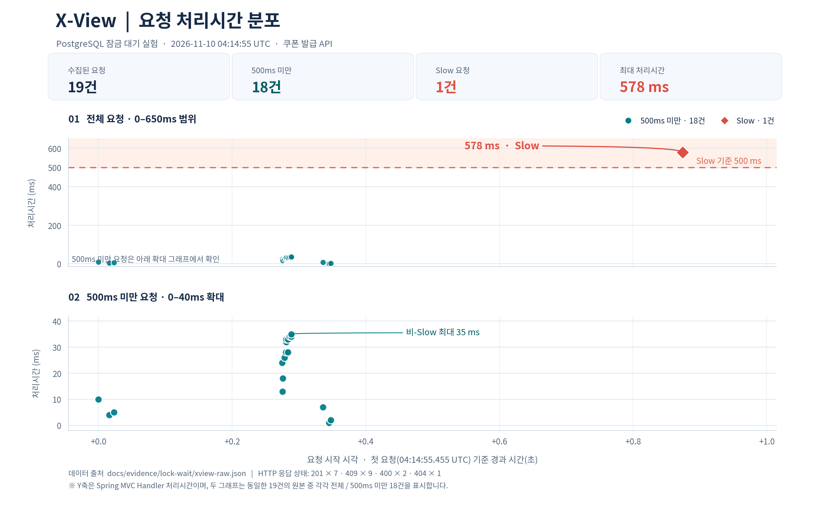
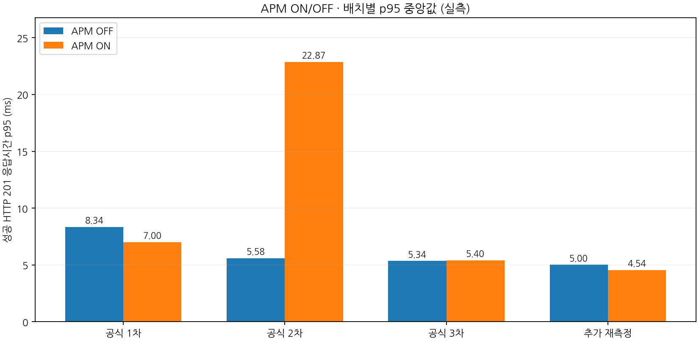
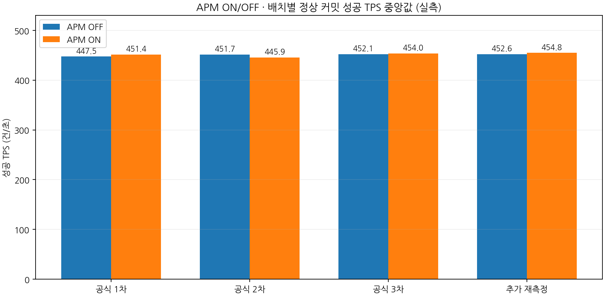
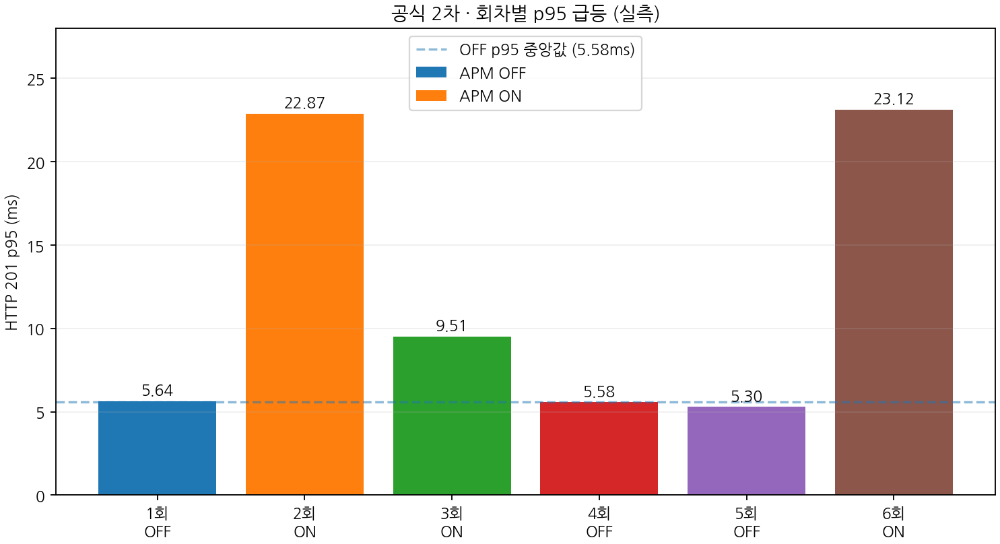

# Spring Boot로 쿠폰 발급의 잠금 대기를 추적한 경량 APM

APM(Application Performance Monitoring)은 애플리케이션의 성능을 관찰하고 문제의 원인을 찾는 데 사용하는 도구입니다.

기존 APM이 제공하는 기능을 사용하는 것에서 나아가, 내부에서 어떤 정보를 수집하고 어떻게 문제를 추적하는지 직접 구현하며 이해해 보고 싶었습니다.

특히 Spring Boot의 요청 처리 과정과 PostgreSQL의 잠금, 동시성 문제를 함께 살펴보고 싶었습니다.

이를 위해 쿠폰 발급 API를 대상으로 간단한 APM을 만들었습니다. 요청에 걸린 시간을 기록하고, 느린 요청의 스레드 상태를 수집한 뒤, 실제 데이터베이스에서 잠금이 발생했는지 확인하는 방식입니다.

이 과정에서 가장 중요했던 것은 **요청이 느렸다는 사실과 왜 느렸는지를 구분하는 일**이었습니다.

## 요청의 어느 부분을 관찰할 것인가

처음 결정해야 했던 것은 계측 범위였습니다.

모든 요청을 추적하면 더 많은 정보를 얻을 수 있지만 수집과 저장에 필요한 비용도 늘어납니다. 이번 실험에서는 관측 범위를 제한하기 위해 `@ApmTrace`가 붙은 Spring MVC Handler만 추적했습니다.

`HandlerInterceptor`를 사용해 요청이 시작될 때 추적 ID를 부여하고 처리가 끝나면 소요 시간과 HTTP 상태를 기록했습니다.

같은 API라도 쿠폰 ID에 따라 주소가 달라질 수 있으므로 실제 URI 대신 Spring 경로 패턴을 저장했습니다.

예를 들어 다음과 같은 요청을 하나의 API로 묶을 수 있습니다.

- `/api/coupons/1/issues`
- `/api/coupons/2/issues`

기록되는 경로:

`/api/coupons/{couponId}/issues`

여기서 측정한 `elapsedMs`는 Spring MVC Handler 처리 시간입니다.

## 느린 요청을 놓치지 않으려면

요청이 느려지는 순간에 프로그램 내부에서 어떤 일이 일어나는지 확인하고 싶었기 때문에 `ApmMonitor`가 100ms 간격으로 실행 중인 요청을 확인하고, 500ms 이상 걸린 요청의 JVM 스택을 수집하도록 했습니다.

스택은 특정 시점에 프로그램이 어떤 메서드를 실행하고 있었는지 보여주는 기록입니다.

다만 일정한 간격으로 검사하는 방식에는 빈틈이 있습니다.

예를 들어 490ms에 요청을 확인했고, 요청이 550ms에 끝나버리면?

500ms를 넘긴 요청이지만 다음 감시 시점까지 살아 있지 않기 때문에 수집 대상에서 빠질 수 있습니다. 이 문제를 해결하기 위해서는 요청이 종료되는 순간에도 처리 시간을 확인해야 했습니다.

```java
public void end(UUID id, int statusCode) {
    ActiveTransaction request = active.get(id);
    if (request == null) return;

    long elapsedNanos = Math.max(
        0, nanos.getAsLong() - request.startedNanos
    );

    var action = request.beginCompletion(
        elapsedNanos >= thresholdNanos
    );

    if (action == ActiveTransaction.CompletionAction.FALLBACK_CAPTURE) {
        capture(request, "COMPLETION_FALLBACK");
    } else if (
        action == ActiveTransaction.CompletionAction.WAIT_FOR_CAPTURE
    ) {
        request.captureDone.join();
    }

    try {
        TransactionSample sample = new TransactionSample(
            id,
            request.method,
            request.route,
            request.startedAt,
            elapsedNanos / 1_000_000L,
            statusCode
        );

        xview.add(sample);
        logJson("APM_TRANSACTION", sample);
    } finally {
        active.remove(id, request);
        request.close();
    }
}
```

요청이 끝날 때 두 상황을 구분합니다.

첫 번째는 아직 스택을 수집하지 않은 경우입니다. 요청 시간이 500ms를 넘었다면 종료 시점에 추가로 수집합니다.

두 번째는 다른 작업에서 이미 스택을 수집하고 있는 경우입니다. 이때는 수집이 끝날 때까지 기다려 중복 기록을 방지합니다.

마지막으로 완료된 요청을 관리 목록에서 제거해 스레드에 대한 참조가 남지 않도록 했습니다.

실제 경계 테스트에서는 490ms에 감시를 실행하고 요청을 550ms에 종료했습니다. 그 결과 `COMPLETION_FALLBACK` 방식으로 SlowTrace가 기록되는 것을 확인했습니다.

## 완료된 요청을 한눈에 살펴보기

수집한 요청 정보를 개별 로그로만 확인하면 전체적인 흐름을 파악하기 어렵습니다.

그래서 완료된 요청을 점으로 표시하는 X-View를 구현했습니다.

X축은 요청 시작 시각, Y축은 Handler 처리 시간입니다.

점 하나가 요청 하나를 나타내므로 특정 시간대에 느린 요청이 몰려 있는지 점검할 수 있습니다.



_그림 1. 요청 19건을 표시한 X-View. 아래 그래프는 500ms 미만 요청 18건을 확대해 보여줍니다._

완료된 요청은 최근 1,000건, SlowTrace는 최근 100건까지만 메모리에 보관하도록 했습니다.
메모리 사용량을 제한하기 위한 선택으로 영구 저장 기능을 위해선 별도 보존 로그를 추가해야 합니다.

## 실제 데이터베이스 잠금을 확인하기까지

느린 요청의 스택을 확인했다고 해서 데이터베이스 잠금이 원인이라고 단정할 수는 없습니다. JDBC 관련 메서드에서 대기하고 있다는 사실은 알 수 있지만, 정확히 무엇을 기다리는지는 별도로 확인이 필요합니다. 이를 위해 PostgreSQL에서 실제 잠금을 발생시키는 테스트를 진행했습니다.

별도의 데이터베이스 연결에서 쿠폰 행을 잠근 상태로 유지하고, 해당 쿠폰을 발급하는 HTTP 요청을 보냈습니다.

쿠폰 발급 로직은 비관적 쓰기 잠금을 사용했습니다.

```java
@Lock(LockModeType.PESSIMISTIC_WRITE)
@Query("select c from Coupon c where c.id = :id")
Optional<Coupon> findLockedById(@Param("id") Long id);
```

이 코드는 쿠폰 정보를 조회하면서 다른 트랜잭션과의 동시 수정을 제어하기 위해 잠금을 요청합니다.

이미 다른 트랜잭션이 같은 행을 잠그고 있다면 잠금을 획득할 때까지 기다릴 수 있습니다.

테스트에서는 `Thread.sleep()`으로 인위적인 지연을 만드는 대신 실제 데이터베이스 잠금을 사용했습니다.

PostgreSQL의 `pg_stat_activity`와 `pg_blocking_pids()`를 통해 어떤 연결이 잠금을 기다리고 있으며 어떤 연결이 이를 막고 있는지 확인했습니다.

### 실제 관측 결과

2026년 11월 10일 테스트에서 다음 결과를 기록했습니다.

| 확인 항목  | 관측값                                |
| ---------- | ------------------------------------- |
| 요청       | `POST /api/coupons/{couponId}/issues` |
| SlowTrace  | 요청 시작 541ms 뒤 수집               |
| X-View     | 578ms, HTTP 201                       |
| PostgreSQL | `wait_event_type=Lock`                |
| 대기 유형  | `transactionid`                       |
| 차단 PID   | 124                                   |
| 대기 PID   | 104                                   |

같은 테스트에서 수집한 JVM 스택에는 JDBC 결과를 기다리는 호출이 포함되어 있었습니다.

PostgreSQL에서도 실제 잠금 대기가 발생한 것을 확인했습니다.

이 테스트를 통해 **느린 요청에서 관찰한 JDBC 대기와 실제 PostgreSQL 잠금 대기가 같은 실험에서 발생했다는 사실**을 알 수 있었습니다.

다만 JVM 스택과 PostgreSQL의 PID를 자동으로 연결한 것은 아니므로, 스택만으로 정확한 DB 잠금 대기 시간을 계산할 수는 없었습니다.

## APM을 켜면 성능은 얼마나 달라질까

APM도 애플리케이션 안에서 실행되는 코드입니다.
요청을 추적하고 시간을 기록하며 스택을 수집하는 과정에는 추가 비용이 발생합니다. 그럼 실제 서비스와 함께 가동될 때 성능 문제를 관찰하기 위한 도구가 오히려 성능에 영향을 주지는 않는지 확인할 필요가 있습니다.

Locust를 사용해 APM을 끈 상태와 켠 상태를 비교했습니다.

각 실행은 최대 사용자 100명, 초당 10명 증가, 준비 60초, 측정 60초 조건으로 진행했습니다.

성능은 다음 두 지표를 기준으로 평가했습니다.

- **성공 p95:** 정상 처리된 HTTP 201 응답 중 95%가 완료된 시간의 경계값
- **성공 TPS:** 60초 동안 데이터베이스에 정상 커밋된 쿠폰 발급 건수를 초당 처리량으로 환산한 값

APM을 켰을 때 p95 증가와 성공 TPS 감소가 각각 15% 이내라면 목표를 통과한 것으로 판단했습니다.



_그림 2. APM OFF/ON 상태의 HTTP 성공 p95 비교._



_그림 3. APM OFF/ON 상태의 성공 TPS 비교._

### 측정 결과

| 구분        | p95 OFF |   p95 ON | p95 변화 | 성공 TPS OFF → ON | 목표 판정 |
| ----------- | ------: | -------: | -------: | ----------------: | --------- |
| 공식 1차    | 8.337ms |  6.999ms |  −16.04% |   447.50 → 451.45 | PASS      |
| 공식 2차    | 5.582ms | 22.872ms | +309.71% |   451.67 → 445.90 | FAIL      |
| 공식 3차    | 5.340ms |  5.399ms |   +1.11% |   452.13 → 454.00 | PASS      |
| 추가 재측정 | 5.004ms |  4.543ms |   −9.21% |   452.55 → 454.78 | PASS      |

공식 1차와 3차에서는 목표를 통과했지만, 2차에서는 p95가 약 4.1배로 증가했습니다.



_그림 4. 공식 2차에서 APM ON 상태의 일부 측정값이 크게 증가했습니다._

### 성능이 급격히 나빠진 이유는 무엇이었을까

당시 테스트는 로컬 환경에서 진행했습니다.

같은 컴퓨터의 다른 터미널에서 RAG 관련 작업처럼 자원을 많이 사용하는 작업을 함께 실행했던 기억이 있습니다. 이러한 작업이 CPU나 메모리 등의 자원을 공유하면서 측정 결과에 영향을 주었을 가능성이 있습니다.

당시 다른 프로세스의 자원 사용량을 기록하지 않았으므로 실제 원인이라고 단정할 수는 없습니다.
후속 진단에서 동기 로깅과 비동기 로깅의 p95 차이는 0.38%였습니다.
동기 로깅이 지연 증가의 주요 원인이라는 가설을 뒷받침하기에는 부족한 결과였습니다.

추가 재측정에서는 성능 목표를 통과했지만 공식 2차 측정에서 지연이 급증한 원인을 확인하지는 못했습니다.

이번 실험에서 얻은 가장 중요한 교훈은 성능 측정값 자체보다 **측정 환경을 통제하고 기록하는 일이 선행되어야 한다는 것**이었습니다.

## 구현과 검증의 범위

이번 구현에서 확인한 주요 기능은 다음과 같습니다.

| 기능            | 확인한 내용                         |
| --------------- | ----------------------------------- |
| 요청 추적       | 선택한 Handler의 시작과 종료 연결   |
| SlowTrace       | 500ms 경계와 종료 시점 보완 캡처    |
| 중복 방지       | 동시 캡처 중복 및 종료 처리         |
| X-View          | 완료 요청의 시각화와 보관 개수 제한 |
| PostgreSQL 잠금 | 실제 잠금 대기와 타임아웃 처리      |
| APM ON/OFF      | 요청 정합성과 성능 비교             |

## APM이 필요한 이유를 이해하다

처음에는 APM을 요청 시간을 기록하고 느린 구간을 찾아내는 도구라고 생각했습니다.

직접 구현해 보니 중요한 것은 단순히 시간이 얼마나 걸렸는지 확인하는 일이 아니었습니다.

같은 500ms의 지연이라도 애플리케이션 내부의 계산 때문인지, 데이터베이스의 잠금 때문인지, 외부 요청을 기다린 것인지에 따라 해결 방법은 달라집니다.

이번 실험에서는 Handler 처리 시간, JVM 스택, PostgreSQL 잠금 상태를 각각 관찰했습니다. 각 기록이 무엇을 보여주는지, 반대로 무엇까지는 설명할 수 없는지도 확인했습니다.

성능 평가에서도 비슷한 경험을 했습니다. 측정값이 크게 달라졌지만 당시 시스템의 자원 상태를 충분히 기록하지 않아 원인을 확정할 수 없었습니다.

**APM은 단순히 느린 요청을 찾아내는 도구가 아니라, 성능 문제를 추측에만 의존하지 않고 확인할 수 있도록 근거를 남기는 도구였습니다.**

이번 구현은 그 필요성을 직접 이해해 보는 과정이었습니다.

## 참고 자료

- [Coupon APM Lab 저장소](https://github.com/kim-thub/coupon-apm-lab)
- 검증 기록 기준: 2026년 11월 10일
