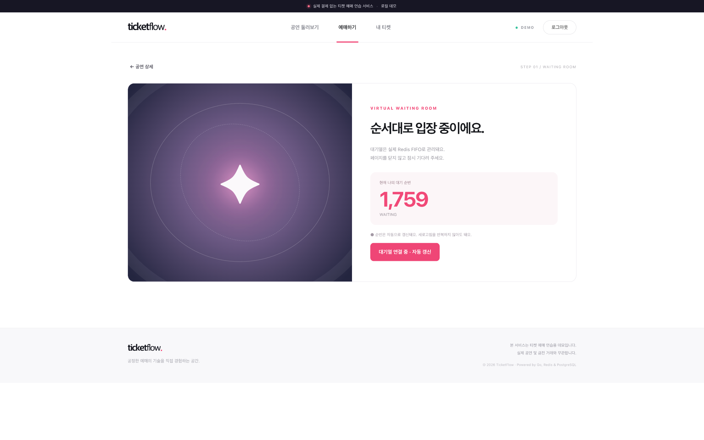
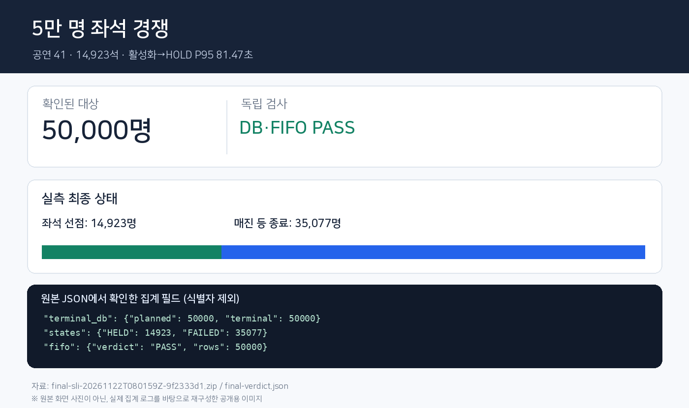
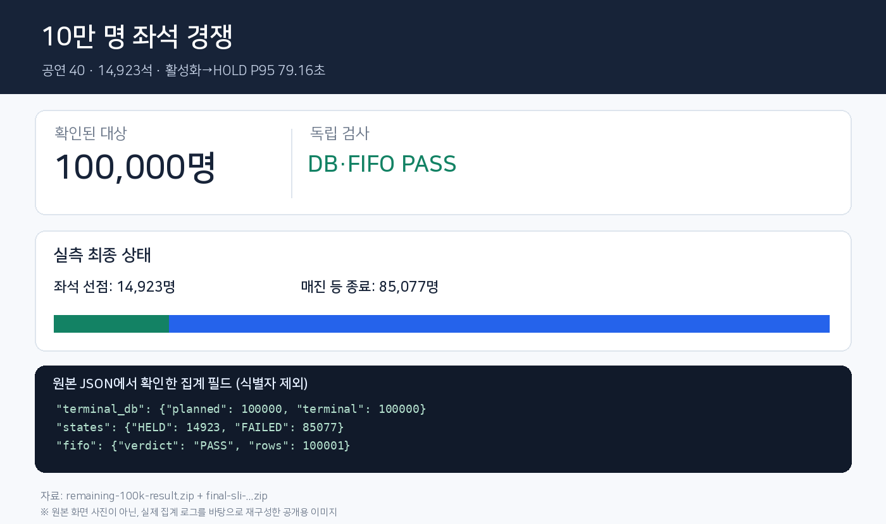

# 고동시성 티켓 예매를 연습하며 SLI/SLO와 1,000 TPS를 검증했다

인기 공연의 예매가 시작되면 한꺼번에 몰린 요청 때문에 사이트가 느려지거나 접속이 끊기는 경우가 있다. TicketFlow는 그런 티켓 예매 시스템을 비슷하게 구현해 고동시성 환경을 직접 연습하려고 만든 프로젝트다. 대기열, 좌석 선택, 결제, 발권을 연결하면서 요청이 몰릴 때도 예매 상태와 좌석 기록이 어긋나지 않는지 확인하고 싶었다. 검증 과정에서는 14,923석을 두고 5만 명과 10만 명이 각각 경쟁하는 시험을 진행했다.

좌석 중복 예약이 발생하지 않는지 확인하는 것만으로는 접속 폭주 상황을 충분히 살펴볼 수 없었다. 얼마나 많은 좌석 선점을 처리할 수 있는지도 확인하고 싶었다. 그래서 SLI/SLO를 정하면서 **1,000 TPS를 최소 60초 동안 달성하는 것**을 주요 성능 목표로 삼았다. 이때 TPS는 **PostgreSQL에 정상 커밋된 좌석 선점(HOLD)**을 기준으로 계산했다. 목표를 검증하기까지 코드와 시험 구성을 여러 차례 수정했다.

아래는 로컬에서 실행한 대기열 화면이다. 사용자에게 표시되는 대기 순번과 서버가 기록한 성공 HOLD TPS는 서로 다른 값이다.



_로컬 대기열 화면. 표시된 순번은 성능 시험 결과가 아니다._

## SLI/SLO를 정하면서 가장 중요하게 둔 목표

SLI는 실제로 측정한 지표이고, SLO는 그 지표에 대해 미리 정한 목표다. 예를 들어 HOLD API 응답 시간 P95가 70ms라면 70ms는 측정값이고, 200ms 이하로 유지하겠다는 기준은 목표다.

상용 서비스에서 수집한 기준선이 없는 로컬 Docker 환경이라 목표를 정하는 데부터 고민이 필요했다. 좌석 중복 예약처럼 허용할 수 없는 오류는 0건으로 두고, HTTP 지연과 자원 사용률은 별도 목표를 정했다. 대기열 상태 조회부터 결제 API까지 경로별 P95와 P99를 나눠 기록했다.

가장 많은 시간을 들인 목표는 **성공 HOLD 커밋 1,000 TPS를 60초 이상 유지하는 것**이었다. HOLD는 결제 완료가 아니라 좌석을 임시로 확보한 상태다. HTTP 요청 수나 대기열 입장 건수는 성공 HOLD TPS에 포함하지 않았다. 각 요청이 데이터베이스에 정상 커밋됐는지를 기준으로 측정했다.

초기 기준에는 HOLD HTTP 응답 P95 200ms, P99 500ms 이하, 입장 활성화부터 HOLD 성공까지의 경과 시간 P95 30초 이하, 운영 DB 연결 풀 P95 80% 이하도 포함했다. 이 중 **활성화부터 HOLD 성공까지의 P95**는 목표와 시험 환경을 검토해 완화했다. 최초 기준과 변경 이력은 글 후반의 표에 함께 남겼다.

## 요청 수 대신 성공적으로 커밋된 HOLD를 측정했다

요청 수가 많다고 좌석 선점을 많이 처리한 것은 아니다. RPS(초당 HTTP 요청 수)에는 좌석 충돌과 매진 응답도 포함된다. 대기열 입장 허가 역시 좌석 선점 성공과 다르다. 그래서 최대 처리량을 측정할 때는 **PostgreSQL에 정상 커밋된 HOLD 수를 초당으로 환산했다.** 모든 API 요청을 합친 처리량이나 결제 완료 TPS를 뜻하지는 않는다.

이 기준을 정하자 실험 설계부터 바꿔야 했다. 경쟁용 공연에는 좌석이 14,923개뿐이었다. 성공 HOLD 1,000건을 60초 동안 기록하려면 적어도 60,000건의 성공 커밋이 필요하다. 좌석이 먼저 매진되면 이후의 성공 TPS는 자연스럽게 0이 된다. 이를 서버 처리 능력이 부족한 결과와 혼동하면 안 됐다.

대기열에도 초당 1,000건의 입장 허용률을 설정했지만, 입장 허가와 좌석 선점 성공은 서로 다른 단계다. 그래서 시험을 세 가지로 나눴다.

| 실험 | 확인하려는 것 |
|---|---|
| 5만 명 경쟁 | 실제 대기열을 거쳐 좌석을 다투는 동안 최종 상태와 정합성이 유지되는가 |
| 10만 명 경쟁 | 경쟁 규모가 커져도 좌석 및 대기열의 정합성이 유지되는가 |
| 사전 입장 HOLD 용량 시험 | 입장에 걸리는 시간을 제외하면 좌석 선점 경로는 1,000 TPS를 처리하는가 |

HOLD 용량 시험에서는 실제 입장 토큰을 미리 발급했다. 따라서 여기서 얻은 TPS를 대기열 진입부터 좌석 선점까지 포함한 종단 간 처리량으로 소개하지 않았다.

## 1,000 TPS를 달성하기까지 반복한 수정

첫 시험부터 목표를 충족하지는 못했다. 대기열을 포함한 초기 시험에서는 평균 성공 HOLD 처리량이 1,000 TPS에 못 미쳤다. 초기에 대기열까지 포함해 측정한 시험의 전체 평균은 587.33 TPS였고, 부하 발생 작업 41,596회가 실행되지 못했다. 이 결과만 놓고 서버가 어느 단계에서 막혔는지 판단할 수는 없었다. 입장 허용률, 좌석 재고, DB 선점 처리, 부하 발생기의 한계가 한 실험에 섞여 있었기 때문이다.

시험을 반복하면서 배포 준비 과정과 Redis Lua 스크립트의 호출 계약에서 발견한 문제를 수정했다. 부하 발생기가 계획한 요청을 실제로 끝까지 실행했는지 확인하는 검사도 보강했다. 대기열 입장과 좌석 선점을 한꺼번에 측정해서는 병목을 구분하기 어려웠기 때문에, 실제 입장 토큰을 미리 발급한 뒤 HOLD 경로를 따로 측정했다. 마지막 단계에서는 서비스 코드를 더 바꾸지 않고 공연별 커밋 수와 사용자별 결과를 확인하는 검증을 보완했다.

대기열을 포함한 시험과 사전 입장 시험은 측정 조건이 다르다. 따라서 두 시험의 처리량 차이를 코드 개선 효과로 계산할 수는 없었다. 대신 입장 단계의 영향을 분리한 시험에서 좌석 선점 경로가 **1,000 TPS 목표를 충족했다**는 사실을 확인했다.

## 60초 동안의 성공 커밋을 어떻게 검증했나

별도 공연에 좌석 120,000개를 준비하고 90,000명의 HOLD 시도를 발생시켰다. 목표 부하는 초당 1,200회씩 75초였다. 그중 **60초 이상 이어진 구간**에서 성공 커밋 수가 얼마나 증가했는지 계산했다.

PostgreSQL에서 커밋 수를 조회하는 데도 시간이 든다. 조회 시작과 종료 시각은 알 수 있지만 정확히 어느 순간의 DB 스냅샷을 읽었는지는 특정하기 어렵다. 그래서 커밋 증가량을 가능한 가장 긴 경과 시간으로 나눠 처리량의 보수적 하한을 구했다. 짧은 구간을 선택해 TPS가 높아 보이는 일을 피하려는 계산이다.

실제 평가기 `scripts/evaluate-show-capacity.py`의 계산 부분이다.

```python
# 각 샘플의 조회 시작과 종료 시각을 고려한 보수적 경계
minimum=b[0]-a[1];maximum=b[1]-a[0]
if minimum<window:continue

delta=b[2]-a[2]
lower=delta/maximum
upper=delta/minimum
```

샘플이 빠지거나 공연별 커밋 수가 확인되지 않으면 값을 채워 넣지 않았다. 보수적으로 계산한 하한으로도 1,000 TPS를 넘는지 확인했다.

| 항목 | 실측값 |
|---|---:|
| 60초 이상 유효 구간 성공 커밋 | 70,550건 |
| 성공 HOLD TPS 보수적 하한 | **1,153.45 TPS** |
| HOLD HTTP 응답 P95 | 69.88ms |
| HOLD HTTP 응답 P99 | 115.39ms |
| 서버 오류 | 0건 |
| 부하 발생 작업 누락 | 0건 |
| HOLD 시도 결과 대조 | 90,000/90,000명 |

최종 사전 입장 시험의 전체 평균은 1,113.27 TPS였고 부하 발생 작업 누락은 0회였다. 60초 이상 유효 구간만 따져도 보수적 하한이 **1,153.45 TPS**였다. 코드와 시험 구성을 여러 차례 수정한 끝에 별도의 HOLD 용량 시험에서 1,000 TPS 목표를 충족했다. 이 결과는 대기열 진입부터 HOLD 성공까지의 종단 간 처리량을 보증하지는 않는다.

## 5만 명과 10만 명 경쟁으로 정합성을 확인했다

접속자가 몰리는 티켓 예매 시스템을 연습하려면 처리량뿐 아니라 경쟁 결과도 확인해야 했다. 먼저 5만 명이 참여하는 시험을 진행하고, 이어서 10만 명이 경쟁하는 시험을 별도로 실행했다. 두 시험에서 판매 좌석은 각각 14,923석이었다. 모두가 좌석을 선점할 수는 없으므로 매진으로 끝난 사용자까지 포함해 **각 사용자의 최종 결과가 남았는지**, 같은 좌석이 중복 선점되지 않았는지를 확인했다.

| 측정 항목 | 5만 명 경쟁 | 10만 명 경쟁 |
|---|---:|---:|
| 전체 참여자 | 50,000명 | 100,000명 |
| 좌석 선점 성공 | 14,923명 | 14,923명 |
| 매진 등으로 경쟁 종료 | 35,077명 | 85,077명 |
| 최종 상태 미확정 | **0명** | **0명** |
| DB 정합성 감사 | 위반 0건 | 위반 0건 |
| Redis 대기 순서 감사 | 통과 | 통과 |



_5만 명 경쟁의 종료 상태와 정합성 감사 요약._



_10만 명 경쟁의 종료 상태와 정합성 감사 요약. 5만 명 시험과는 별도로 실행했다._

이후 권한과 장애 상황도 따로 검사했다. 비인가 요청 1,011건에서는 허가되지 않은 신규 예약이 만들어지지 않았다. Worker 강제 종료, 재시작, 응답 유실 모의, Consumer 복구를 포함한 생명주기 감사에서는 14,000명의 최종 결과를 대조했다. 이 감사들은 경쟁 시험과 독립적으로 수행했다.

## HOLD 경과 시간 목표는 측정 범위와 환경을 고려해 완화했다

1,000 TPS는 기준을 유지한 채 코드와 실험 구성을 반복해서 검토한 목표다. **활성화부터 HOLD 성공까지의 P95**에는 다른 판단이 필요했다. 최초 기준은 30초였고 실측값은 5만 명에서 81.47초, 10만 명에서 79.16초였다. 처음 정한 30초 기준으로는 두 시험 모두 FAIL이었다.

이 지표는 HOLD API 한 번의 응답 시간이 아니다. 입장권 활성화 후 봇이 좌석을 고르고, 충돌이 나면 다시 시도해 선점에 성공하기까지의 시간이다. 봇의 선택과 재시도 시간까지 포함하는 지표를 단일 API 지연처럼 다뤄서는 안 됐다. 로컬 경쟁 시나리오와 실제 측정 범위를 함께 고려해 목표가 적절한지 다시 검토했다.

그 결과 이번 로컬 경쟁 시나리오의 목표를 **P95 30초 이하에서 100초 이하로 완화했다.** 새 기준에서는 두 시험 모두 목표를 충족한다. 이 변경으로 처리 시간이 단축된 것은 아니다. 100초는 실제 사용자 데이터를 근거로 한 운영 기준이 아니라 이번 봇 시나리오와 시험 환경을 평가하기 위해 정한 목표다. 변경 전 30초 기준의 FAIL도 표에 남겼다.

## 부하 발생기 DB 연결 풀은 평가 대상에서 뺐다

별도로 조정한 항목은 DB 연결 풀 사용률이었다. 처음에는 운영 API와 백그라운드 작업 처리 서버(Worker)뿐 아니라 부하 발생기에도 같은 P95 80% 이하 기준을 적용했다. 5만 명 시험에서 부하 발생기의 DB 연결 풀 사용률은 100%, 10만 명 시험에서는 75%였다. 이 값은 운영 서비스가 사용하는 연결 풀이 아니라 부하 발생기의 상태를 보여 준다.

따라서 부하 발생기의 DB 연결 풀은 합격 조건에서 제외하고 관측용 SLI로 남겼다. 부하 발생기가 포화되면 시험 결과를 해석하는 데 영향을 줄 수 있으므로 계속 확인할 필요는 있다. 운영 API와 Worker의 DB 연결 풀 P95 80% 이하 목표는 유지했다.

## 최초 SLI/SLO 전체 항목과 실측 결과

처음 정한 SLI/SLO 항목을 빠짐없이 대조했다. 아래 표의 `PASS(별도)`는 특정 독립 시험 또는 수집된 표본에서 해당 기준을 충족했다는 뜻이다. `평가 보류`는 원래 목표와 같은 조건으로 판단할 자료가 부족하다는 뜻이고, `관측`은 처음부터 수치 합격 기준이 없는 지표다.

처음 기준을 적용한 종합 판정에는 `FAIL`이 있었다. 이후 기준을 바꾼 항목의 최초 판정과 실측값은 그대로 기록했다. 서로 다른 시험에서 나온 PASS를 합쳐 한 번의 전체 운영 시험이 통과했다고 주장하지는 않았다.

### 처리량과 API 응답 시간

| SLI | 최초 목표 | 최종 실측 | 판정 | 비고 |
|---|---|---|---|---|
| 성공 HOLD 커밋 처리량 | 1,000 TPS 이상, 60초 이상 | 하한 1,153.45 TPS | **PASS** | 사전 입장 HOLD 용량 시험 |
| 대기열 입장 허용 | 초당 최대 1,000건 | Redis 기록의 최고 1,000건/s | **PASS(별도)** | 입장 허용 설정의 준수 확인, 성공 HOLD TPS와 별개 |
| 대기열 진입 HTTP P95/P99 | 100/200ms 이하 | 3.39/3.84ms | **PASS(별도)** | 독립 40건, 대규모 경쟁 응답 시간은 미검증 |
| 대기열 상태 조회 P95/P99 | 50/100ms 이하 | 3.87/5.25ms | **PASS(별도)** | 독립 161건 |
| 대기열 활성화 P95/P99 | 100/200ms 이하 | 3.14/3.54ms | **PASS(별도)** | 독립 40건 |
| 좌석 조회 P95/P99 | 150/300ms 이하 | 3.30/4.26ms | **PASS(별도)** | 독립 40건 |
| HOLD HTTP P95/P99 | 200/500ms 이하 | 69.88/115.39ms | **PASS** | 사전 입장 HOLD 용량 시험 |
| 예매 결제 API P95/P99 | 300/700ms 이하 | 5.12/5.76ms | **PASS(별도)** | 독립 40건, 결제부터 발권까지의 시간과 구별 |

### 사용자 경험과 서비스 신뢰성

| SLI | 최초 목표 | 최종 실측 | 최초 기준 판정 | 비고 |
|---|---|---|---|---|
| 활성화부터 HOLD 성공 P95 | 30초 이하 | 5만 81.47초, 10만 79.16초 | **FAIL** | **목표와 로컬 시험 환경을 고려해 100초 이하로 완화. 변경 후 두 시험 모두 충족** |
| 결제 요청부터 확정 P95 | 10초 이하 | 같은 정의의 종단 간 분모 부족 | **평가 보류** | 결제 API 시간과 발권 확인 시간은 각각 별도 관측 |
| 결제 요청부터 티켓 확인 P95 | 별도 관측, 최초 목표와 구간이 다름 | 독립 40명 시험 3.18초 | 관측 | 원래 결제 요청부터 확정까지의 SLO를 대신하지 않음 |
| TTFB | 경로별 수집 후 기준선 설정 | HOLD P95 69.66ms, P99 115.29ms | 관측 | 최초부터 고정 수치 목표 없음 |
| 대기열 대기 시간 P50/P95/P99 | 순번별 측정, 고정 시간 목표 없음 | 순번별 근사값 산출 | 관측 | 실제 요청 도착부터의 시간을 직접 잰 값은 아님 |
| 유효 요청의 서버 오류율 | 3% 이하 PASS, 3% 초과 5% 이하 WARNING, 5% 초과 FAIL | HOLD 시험 0% | **PASS(별도)** | 5만 또는 10만 경쟁 전체 유효 요청 기준은 **평가 보류** |
| 요청 기준 API 가용성 | 97% 이상 | 전체 경쟁의 정확한 분모 부족 | **평가 보류** | 장기 99.9%는 상향 목표였고 달성 주장 없음 |
| 접수 요청의 종결 추적 | 미확정 0건 | 5만과 10만 각 0명, 생명주기 감사 14,000명 전원 대조 | **PASS(별도)** | 실험별 종결 확인, 과거 원본 감사 미완료 판정은 보존 |

### 자원, 데이터베이스, Redis

| SLI | 최초 목표 | 최종 실측 | 판정 | 비고 |
|---|---|---|---|---|
| API와 Worker CPU P95 | 할당 CPU 대비 75% 이하 | 5만 표본 API 74.69%, Worker 17.41%, 각각 단일 코어 환산 | **평가 보류** | 서비스 CPU 할당량이 없어 최초 목표의 분모와 다름 |
| API와 Worker 메모리 | 할당 메모리 대비 80% 이하 | 5만 표본 Docker 표기 API 3.03%, Worker 0.45% | **평가 보류** | 서비스별 메모리 제한이 없어 최초 기준 판정 불가 |
| 운영 API DB 연결 풀 P95 | 80% 이하 | 5만 46.88%, 10만 0% | **PASS** | 운영 서비스 지표 |
| 운영 Worker DB 연결 풀 P95 | 80% 이하 | 5만 8.33%, 10만 4.17% | **PASS** | 운영 서비스 지표 |
| 부하 발생기 DB 연결 풀 P95 | 초기에는 동일하게 80% 이하 | 5만 100%, 10만 75% | **FAIL** | **변경: 부하 발생기는 SLO에서 제외하고 관측용 SLI로 유지** |
| 운영 중 PostgreSQL 잠금 대기 P95 | 100ms 이하 | 완료된 대기 시간 분포 없음 | **평가 보류** | 별도 통제 시험의 P95 21.06ms로 대체할 수 없음 |
| 통제된 PostgreSQL 잠금 시험 P95 | 별도 관측, 운영 중 잠금 대기와 다름 | 80회 시험 21.06ms | 관측 | 로컬 SQL 실행 및 psql 호출 오버헤드가 포함된 측정값 |
| 디스크 사용률 | 80% 이하 | 공유 파일시스템 표본 15% | **PASS(별도)** | 수집 시점에서만 확인 |
| DB I/O와 네트워크 | 기준선 수집 | Docker 누적 입출력 표본 수집 | 관측 | 최초부터 고정 SLO 없음 |
| Redis 명령 지연 P95 | 10ms 이하 | Queue 0.016ms 이하, Cache 0.008ms 이하 | **PASS(별도)** | 서버 내부 실행 시간, 네트워크 왕복 시간 아님 |
| Redis 재연결 상태 | 상태 관측 | 전체 복구 동작을 아우르는 정량 판정 없음 | 관측 | 별도 수치 SLO 없음 |

### 정합성과 장애

| SLI | 최초 목표 | 최종 실측 | 판정 | 비고 |
|---|---|---|---|---|
| 좌석 중복 활성 예약 | 위반 0건 | 감사 범위 위반 0건 | **PASS** | 5만, 10만 공연 사후 DB 감사 |
| 좌석 재고 및 예약 참조 | 불일치 0건 | 감사 범위 불일치 0건 | **PASS** | 공연별 스냅샷 |
| 멱등성 위반 | 0건 | HOLD 사용자 90,000명 결과 대조 | **PASS(별도)** | 해당 시나리오의 원장 대조 |
| 권한 위반 | 비인가 예약 0건 | 비인가 요청 1,011건에서 신규 예약 0건 | **PASS** | 독립 보안 감사 |
| FIFO 대기 순서 | 위반 0건 | 5만, 10만 감사 통과 | **PASS** | 수집된 입장 기록 기준 |
| 활성 입장 슬롯 상한 | 100,000개 초과 0건 | 최대 표본 5만 40,688개, 10만 85,630개 | **부분 확인** | 5만 PASS, 10만 전체 구간은 **평가 보류** |
| 접수된 요청 누락 | 0건 | 생명주기 감사 14,000명 전원 대조 | **PASS(별도)** | 정의된 정상 및 장애 시나리오 |
| OOM 및 비정상 재시작 | 시험 기간 내 0건 | 수집한 경쟁 시험 표본에서 0건 | **PASS(별도)** | 장기 안정성 보증은 아님 |

CPU 사용률이나 오류율처럼 수치가 남아 있는 항목도 최초 기준에 바로 대입할 수 없는 경우가 있었다. 예를 들어 CPU 할당량을 정하지 않은 상태에서 측정한 사용률은 할당 CPU 대비 75%라는 목표와 분모가 다르다. 서버 원인 타임아웃과 정상적인 좌석 충돌을 구분한 전체 요청 원장이 없다면, 일부 시험의 5xx 0건만으로 5만 명 경쟁 전체의 요청 기준 가용성을 판정할 수도 없다.

## SLI/SLO를 적용하며 배운 것

접속자가 몰리면 쉽게 불안정해지는 티켓 예매 환경을 비슷하게 만들고, 그런 상황에서 서버와 데이터가 어떻게 움직이는지 직접 확인하는 것이 이 프로젝트의 출발점이었다. 5만 명과 10만 명 경쟁 시험에서는 대기 순서와 좌석 정합성을 확인했다. 이렇게 규모를 나눠 시험해 보니 기능 구현과 성능 검증이 서로 다른 작업이라는 점이 더 분명해졌다.

SLI/SLO를 적용한 뒤 가장 많은 시간을 쓴 부분은 **성공 HOLD 1,000 TPS**였다. 처리량을 측정하겠다고 정하는 것만으로 끝나지 않았다. 성공 커밋이 무엇인지 정하고, 재고가 충분한 별도 공연을 마련하고, 대기열과 HOLD를 분리한 뒤, 부하 발생기의 누락까지 확인해야 했다. 코드와 검증 환경을 여러 차례 수정하고 나서야 목표를 충족했다는 근거를 남길 수 있었다.

처음에는 목표 수치를 정하면 성능을 평가할 수 있을 거라고 생각했다. 실제로는 무엇을 한 건으로 셀지, 어느 구간을 측정할지부터 정해야 했다. 다음에는 목표 수치와 함께 측정 기준과 시험 조건도 먼저 설계하려고 한다.
